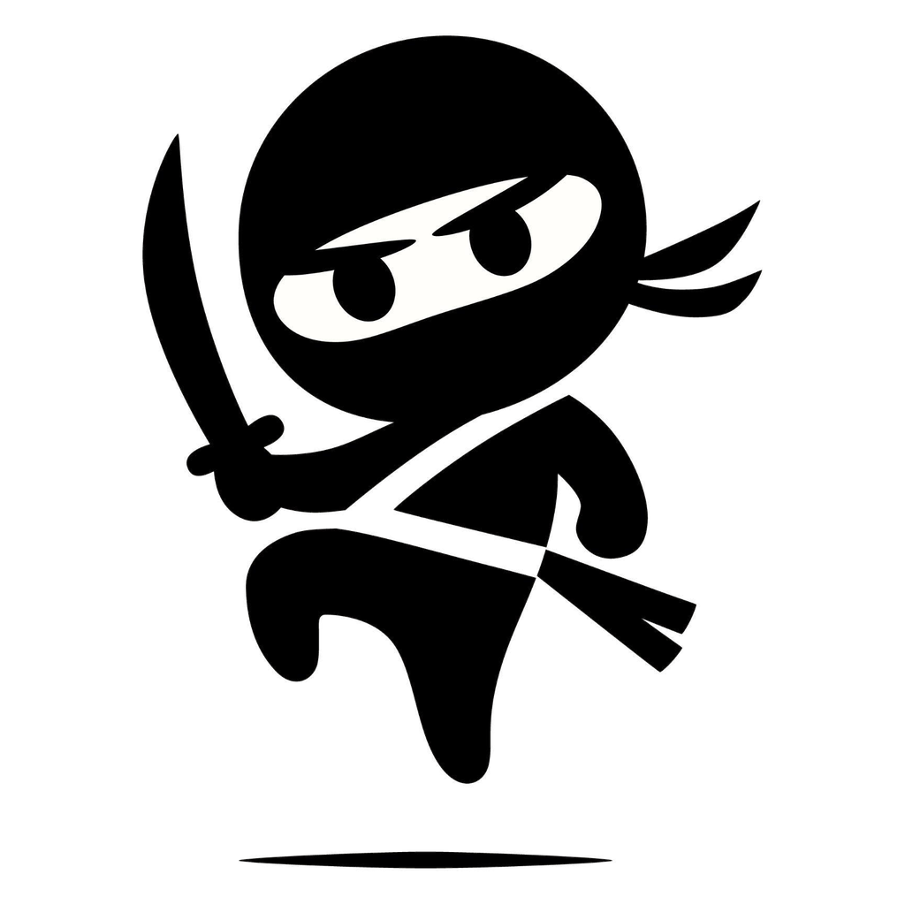

<p align="center"></p>

# Rowdy Sticks

Create, customise and animate stickmen, and stage fights between them, with
weapon hits, blood, screen shake and baked ragdoll physics. Runs in the browser
or as a ~6 MB desktop app via [TinyJS](https://tinyjs.app/).

## Run

```sh
npm install
npm run dev          # browser: http://127.0.0.1:5173  (?demo forces the demo scene)
tinyjs dev           # native window with hot reload
tinyjs build         # dist/Rowdy Sticks.app (ad-hoc signed, this Mac's CPU)
npm test             # headless model/physics tests
```

## What you can do

- **Build bodies**: 0–3 arm pairs and 0–3 leg pairs (normal or tentacle), up to
  10 hip tentacles, plus torso, head, arm and leg proportions.
- **Head features**: hair (short, spiky, long, ponytail, bun, samurai topknot,
  mohawk), horns (devil, oni, ram), antennae, halo, crown, helmets (kabuto,
  knight, army, viking), ninja hood, hachimaki, straw kasa, cap, cowboy hat,
  eyes and beard.
- **Body extras**: scarf, belt/obi, sword on the back, cape, skirt, chest armour.
  Ribbons, hair and capes flutter as the animation plays.
- **Weapons**: katana, wakizashi, tantō, nodachi, bō, naginata, yari, kunai,
  shuriken, sai, tonfa, nunchaku, kusarigama, kama, tessen, kanabō, yumi,
  longsword, knife, pistol, revolver and SMG. Each keyframe stores a weapon's
  hand, angle, visibility, chain swing and firing, and weapons can be released
  to fly or fall freely.
- **Animate** with keyframes (eased interpolation, onion skin) and FK/IK posing,
  or insert preset moves that adapt to extra limbs and tentacles: stance, idle,
  bow, victory, tentacle wiggle, walk, run, jump, punch, 1-2 combo, side kick,
  high kick, overhead slash, thrust, sweep, block, throw, shoot ×2, stagger and
  fall.
- **Interactions**: blades, blunt weapons, fists, feet and tentacle tips are
  hit-tested against other stickmen every frame. Gunshots ray-cast, and blades
  clash with sparks. Hits are marked on the timeline.
- **Ragdoll**: a Verlet simulation from any frame or from a detected hit (pushed
  in the blow's direction), with fading muscle tone and dropped weapons. The
  result is baked into ordinary keyframes you can edit.
- **Save/load** projects as JSON. **Export** animated GIF, MP4 (H.264 via
  WebCodecs, with a MediaRecorder fallback) and PNG sprite sheets with
  TexturePacker-style JSON.

## Controls

| Action | How |
|---|---|
| Pose a joint | drag a coloured handle (FK); **Shift** or the **IK** toggle drags hands/feet with IK |
| Move a stickman | drag the orange square at the hip, or drag the selected body |
| Rotate a weapon | drag its red diamond (flexible weapons swing their chain; **Alt** rotates) |
| Pan / zoom | Space+drag or right-drag / wheel; double-click to fit |
| Play | Space · ←/→ frame · Shift+←/→ key · Home/End |
| Keys | K add · Delete remove · double-click a timeline row · drag diamonds to retime |
| Pose clipboard | ⌘C / ⌘V · F flip facing · I toggle FK/IK · O onion skin |
| File | ⌘N new · ⌘O open · ⌘S save · ⇧⌘S save as · ⌘E export · ⌘Z / ⇧⌘Z undo/redo |

Every pose edit auto-creates a keyframe at the current frame.

## Layout

```
src/model     data types, skeleton builder/solver, pose interpolation, weapon geometry
src/render    canvas drawing: figures, head features, extras, weapons, effects
src/sim       per-frame world cache, hit detection, ragdoll physics
src/anim      preset moves, demo scene
src/editor    stage (posing), timeline, panels, export dialog, app wiring
src/export    GIF / MP4 / sprite-sheet encoders
src/platform  file I/O: browser downloads or TinyJS dialogs + backend
backend       TinyJS backend (txiki.js): writes and reads files for the page
```
